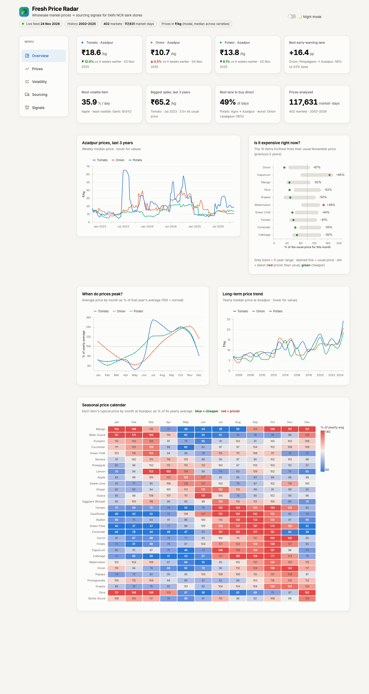
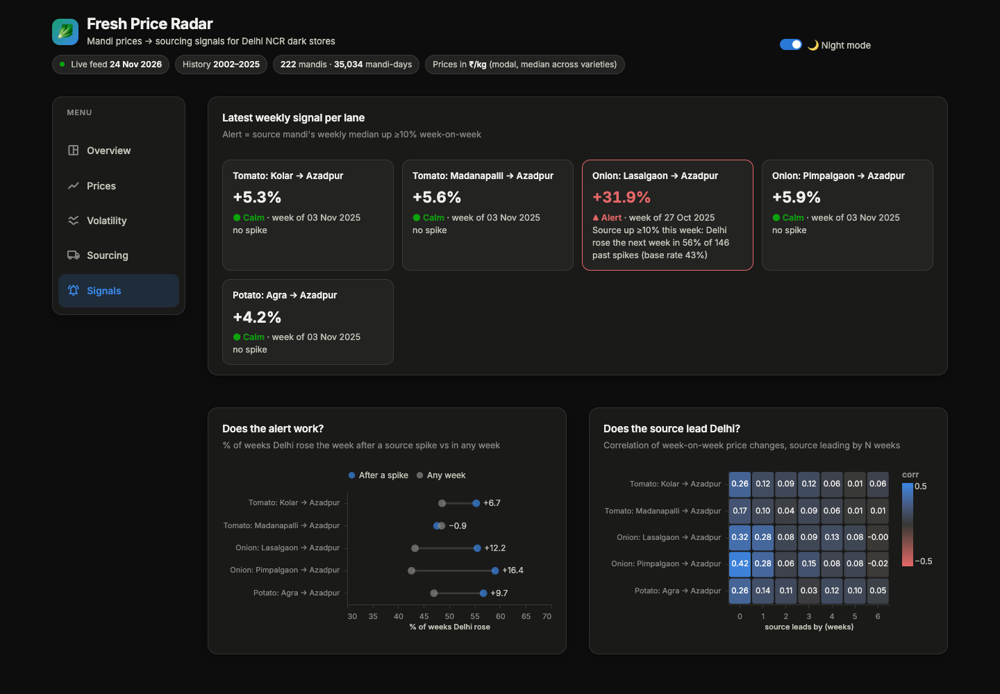
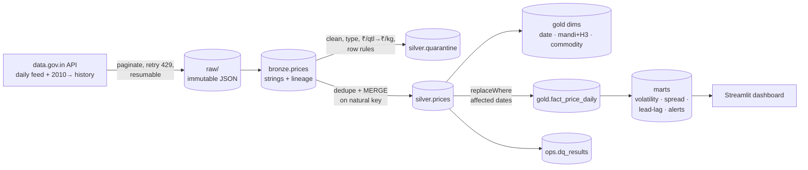
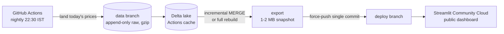

# FreshLens

**Fresh-produce price intelligence for quick commerce.** A self-updating data pipeline and dashboard that
turns India's government wholesale-market (mandi) price feed into sourcing signals for Delhi NCR dark stores.

**Live dashboard:** _link added after the first deploy_ · refreshed every night at 22:30 IST by GitHub Actions.

Every day India's ~3,000 APMC wholesale markets (mandis) report what produce sold for. A dark-store
network in Delhi buys mostly through Azadpur, but the price there is set by what happens days earlier in
Kolar, Madanapalli and Lasalgaon. This project turns the raw government feed into three answers a
category/sourcing team can act on:

1. **How volatile is each SKU right now?** Rolling 7/30-day volatility of daily price moves, used for
   safety stock and price-change cadence.
2. **Is it cheaper to buy at the source mandi?** Delhi price vs. source price + freight, per lane, per day.
3. **Is a Delhi price spike coming?** Whether the source mandi leads Delhi, and a back-tested
   "source up ≥10% this week → Delhi up next week" alert.

| Day | Night |
|---|---|
|  |  |



### How it stays live (no laptop needed)



* **`data` branch**: the raw landing zone, append-only and gzip-compressed (about 19× smaller). This is
  the durable source of truth, and the whole lake can be rebuilt from it (`freshlens rebuild`).
* **Delta lake** in the Actions cache, so a normal night processes only the last 3 landed days
  (idempotent, which also heals a night that failed). On a cold cache the lake is rebuilt from raw.
* **`deploy` branch**: code plus the nightly dashboard snapshot as one replaced commit, so the repo never
  grows. A failed critical data-quality check stops the run before deploy, so bad data never goes live
  and GitHub emails the owner.

## Data

Scope: **30 fresh items** (19 vegetables, 10 fruits and coriander) at Azadpur, Delhi's benchmark wholesale market, plus 5 source markets. Items, English display names and categories live in `config/settings.yaml`. Add a line there and run `freshlens backfill`.

| Source | What | Notes |
|---|---|---|
| [Current daily mandi prices](https://www.data.gov.in/resource/current-daily-price-various-commodities-various-markets-mandi) (`9ef84268…`) | Latest arrival day, all India | Only ever holds *one* day, so history exists only if the job runs every day |
| [Variety-wise daily market prices](https://www.data.gov.in/resource/variety-wise-daily-market-prices-data-commodity) (`35985678…`) | 2010 → late 2025 | Used for the backfill |

Fields: state, district, market, commodity, variety, grade, arrival date, min/max/modal price (₹/quintal).

Things I learned about the source, and handled in code:

* **The API tarpits the default `python-requests` User-Agent.** Requests hang until they time out,
  while `curl` gets answers in 300 ms. The client sends its own User-Agent.
* The two resources disagree on shape. The daily feed uses `snake_case` keys with numeric prices; the
  history feed uses `Title_Case` keys with string prices like `"2,500"`. Bronze normalises both.
* Market names drift (`Azadpur` vs `Azadpur APMC`). Without cleaning, the same mandi-day shows up as
  two rows.
* Page size is capped by the key (10 rows for the public sample key), so pagination follows the
  server's real page size, not the requested one.
* **Offset paging without a sort is unstable.** Pages overlap and rows silently vanish. For Azadpur
  tomato, 3,490 rows came back but only 2,310 were distinct, so **34% of the history was missing**
  while every row count looked right. History pulls now send `sort[Arrival_Date]`, and every scope
  is checked after download (distinct rows vs. the API's `total`) with the result written to its
  `_SUCCESS` marker. There's a test for this.
* The daily feed repeats rows: on 24 Nov 2026, 2,143 rows held only 1,319 distinct ones. Silver
  de-duplicates on the natural key.
* Some mandis send `min = max = 0` with a valid modal price (550 Agra potato rows). That means
  "not reported", so those become null instead of quarantining good modal prices.

## Layers

| Layer | Table | Grain / rule |
|---|---|---|
| raw | `raw/daily/ingest_date=…/run=…/…json` | One immutable snapshot per run. A later run that day can carry corrections |
| bronze | `bronze.prices` | Every value kept as a string, plus `_source, _batch, _source_file, _fetched_at`. Idempotent via `replaceWhere` per batch |
| silver | `silver.prices` | One row per state × district × market × commodity × variety × grade × date. **Delta MERGE**: insert new rows, update only when prices changed *and* the incoming copy is newer |
| silver | `silver.quarantine` | Rows that broke a rule, with the reason: `bad_date`, `min_above_modal`, `modal_above_max`, `bad_modal_price`, `implausible_price`, `missing_key` |
| gold | `dim_date`, `dim_mandi` (lat/lon, **H3 r7**, role), `dim_commodity`, `fact_price_daily` | Deterministic `xxhash64` surrogate keys. The fact table is rebuilt only for the date range a run touched |
| gold | `mart_mandi_daily`, `mart_volatility`, `mart_sourcing_spread`, `mart_lead_lag` (daily), `mart_lead_lag_weekly`, `mart_alert_backtest`, `mart_alerts` | See below |
| ops | `dq_results` | Every check of every run, appended |

**Data-quality checks** run on every load. Critical checks stop the run *after* the result is
recorded: empty load, duplicate natural keys, `min ≤ modal ≤ max`. Warning checks: quarantine rate
above 5%, freshness, tracked mandis that went silent for more than 7 days, commodity coverage.

### How the analysis works

* **Volatility**: the standard deviation of day-on-day log returns over a 7/30-*calendar-day* window
  (`rangeBetween` on day numbers, not row counts). A return is dropped when it spans a reporting gap of
  more than 3 days, so a mandi closed for Diwali doesn't create a fake spike.
* **Sourcing spread** = Delhi modal − (source modal + freight). Freight per lane is an explicit
  assumption in `config/settings.yaml`. Replace it with real lane rates.
* **Lead-lag**: for each lane and each lag k, `corr(Delhi return[t], source return[t−k])`. It runs
  daily (k = 0..10 days) and on **weekly medians** (k = 0..6 weeks). A lag counts only with enough
  paired periods (60 days / 52 weeks) **and** a correlation of at least 0.15. Otherwise the mart says
  "no lead detected" instead of crowning noise.
* **Alert back-test**: the source's weekly median is up ≥10% week-on-week. Is Delhi up the *next*
  week? Each spike episode is counted once (its first week), and the hit rate is compared with the
  base rate (how often Delhi rises in any week). An alert is only useful if it beats the base rate.

## Run it

```bash
./scripts/setup.sh                 # uv deps + project-local JDK 17
echo "DATA_GOV_IN_API_KEY=…" >> .env   # free key: data.gov.in → My Account → Generate Key

uv run freshlens backfill          # history (resumable; safe to Ctrl-C and re-run)
uv run freshlens daily             # today's snapshot → all layers → DQ
uv run freshlens show gold/mart_lead_lag_weekly --where "reliable"
uv run --extra dashboard streamlit run dashboard/app.py   # day/night toggle; ?theme=night&page=Signals links
```

Other commands: `freshlens rebuild` (delete the lake and replay all raw: proves the lake can be rebuilt),
`freshlens gold` (rebuild gold from silver), `freshlens export` (dashboard snapshot), `freshlens report`
(regenerate `docs/findings.md`), `freshlens dq`. `fpr` is a short alias.

**Scheduling.** `.github/workflows/daily.yml` runs the nightly refresh described above. `databricks.yml`
is an alternative that deploys the same job to Databricks (Free Edition, serverless) with a Unity Catalog
volume as storage.

## Tests

`uv run pytest`: 20 tests on local Spark.

* API client: pagination at the server's page size, 429/network retries, and the key never appears in
  errors.
* Cleaning: both feed shapes, gzip and plain raw pages, unit conversion, market-name normalisation, every
  quarantine rule, and only configured items reaching silver.
* **MERGE semantics**: re-running a batch changes nothing, a later correction updates one row, and an
  older copy never overwrites a newer one.
* Landing: sorted history requests, and overlapping pages flagged as incomplete.
* **Analysis**: lead-lag recovers a planted 3-day lag (daily) and a planted 2-week lag (weekly),
  claims no lag without enough overlap, and the spike rule beats the base rate when a lead exists.

CI (`.github/workflows/ci.yml`) runs ruff and pytest on every push to `main`.

## Stack

Python 3.12 · PySpark 4.0 · Delta Lake 4.0 · H3 · Streamlit + delta-rs · pytest · ruff · uv · Databricks Asset Bundles · GitHub Actions

## Results (real data, 2002 → 24 Nov 2026, 30 items, 135k cleaned price rows)

Full tables are in [`docs/findings.md`](docs/findings.md), generated by `freshlens report` from the marts.
Nothing there is typed by hand.

1. **Daily mandi prices are mostly noise.** The best daily lead-lag correlation on any lane is only
   0.07–0.11. On weekly medians, source and Delhi move together in the same week (0.17–0.42). For
   **onion** the effect carries into the following week (Lasalgaon 0.28, Pimpalgaon 0.28).
2. **The onion spike rule works.** When Lasalgaon's weekly price jumps ≥10%, Azadpur was up the next
   week **55.5%** of the time against a **43.3%** base rate (146 spikes), averaging **+6.4% vs +1.1%**.
   Pimpalgaon: 59.0% vs 42.6%. Kolar tomato has a smaller edge (55.3% vs 48.6%). Madanapalli tomato
   has none (47.6% vs 48.5%), and the dashboard shows that as clearly as it shows the wins.
3. **Direct onion sourcing rarely pays** at ₹2.5/kg freight. Lasalgaon landed cost beat Azadpur on
   only 18.5% of days (median −₹1.92/kg). Kolar tomato since 2023 beat Azadpur on 64% of days
   (median +₹2.46/kg at ₹4/kg freight). That makes it the lane to price properly with real freight
   quotes.
4. **Tomato is the most volatile SKU at Azadpur** (14.4% daily return stdev), then green chilli
   (14.0%) and potato (13.1%). Onion is 10.9%.

**Caveats.** Freight is an assumption. The back-test is in-sample (no train/test split by year yet),
and the weekly horizon was picked after looking at the weekly correlations. The history feed ends in
Nov 2025; from 24 Nov 2026 the daily job extends it.
